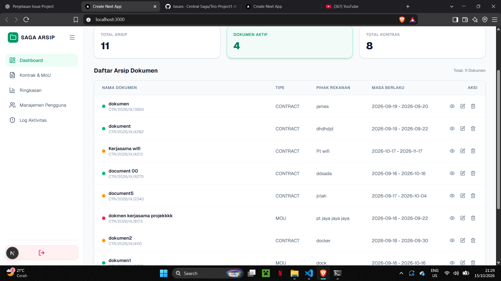
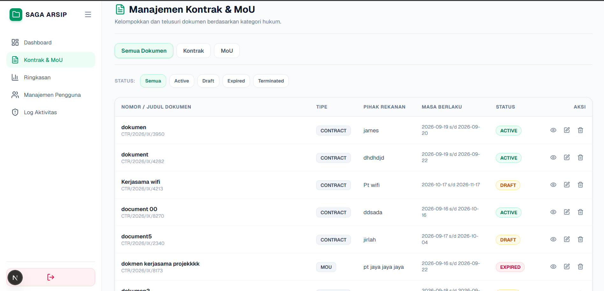
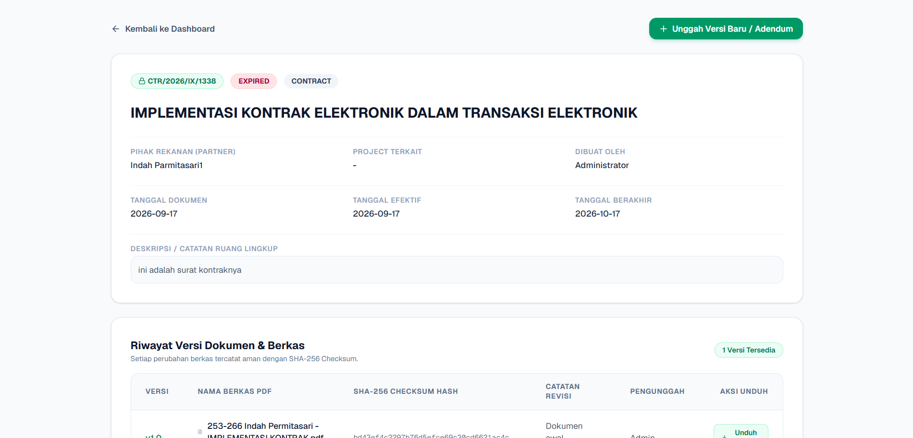

# SAGA — Sistem Arsip Kontrak dan MoU

[](https://github.com/Central-Saga/Trio-Project1-ArsipKontrak/actions/workflows/ci.yml)

SAGA adalah aplikasi web untuk membantu pengelolaan arsip kontrak, Memorandum of Understanding (MoU), proyek, klien, dan riwayat dokumen secara terpusat.

## Fitur

- Autentikasi pengguna dan pengaturan hak akses.
- Pengelolaan proyek dan informasi klien.
- Pengelolaan arsip kontrak, MoU, dan dokumen pendukung.
- Pencatatan versi dokumen.
- Pengelolaan jenis kontrak.
- Pemantauan status dan tanggal berlaku dokumen.
- Pencatatan aktivitas dan notifikasi sesuai fitur yang tersedia pada aplikasi.

## Teknologi

- **Backend:** Laravel 13.17 atau versi kompatibel dalam rentang `^13.17`.
- **Bahasa backend:** PHP 8.3 atau versi kompatibel dalam rentang `^8.3`.
- **Frontend:** Next.js 16.3.4.
- **UI library:** React 19.2.8.
- **Bahasa frontend:** TypeScript 5.x.
- **Database:** PostgreSQL.
- **Containerization:** Docker dan Docker Compose v2.

> Versi setiap teknologi mengikuti konfigurasi yang digunakan dalam repository ini. Periksa `backend/composer.json`, `frontend/package.json`, dan `compose.yaml` untuk mengetahui versi yang tepat.

## Persyaratan

Sebelum menjalankan aplikasi, pastikan perangkat sudah memiliki:

- Git.
- Docker Engine atau Docker Desktop dengan integrasi WSL jika menggunakan WSL.
- Docker Compose v2.
- Terminal yang mendukung perintah Docker Compose.

Periksa instalasi dengan perintah berikut:

```bash
git --version
docker --version
docker compose version
```

Pastikan Docker sedang berjalan sebelum melanjutkan.

## Instalasi dan Menjalankan Aplikasi

### 1. Clone repository

Jika belum memiliki source code, clone repository dari GitHub:

```bash
git clone <URL_REPOSITORY>
cd arsip-kontrak-mou
```

Ganti `<URL_REPOSITORY>` dengan URL repository GitHub yang sebenarnya.

Jika source code sudah tersedia di komputer, lanjutkan dari folder project tanpa melakukan clone ulang.

### 2. Siapkan environment

Salin template environment jika file `.env` belum tersedia:

```bash
cp .env.example .env
```

Jika `.env` sudah ada, jangan menimpanya. Periksa konfigurasi yang diperlukan berdasarkan `.env.example` dan `compose.yaml`.

Jangan membagikan atau mengunggah file `.env` karena file tersebut dapat berisi kredensial dan konfigurasi lokal.

### 3. Build dan jalankan aplikasi

Jalankan dari direktori utama repository yang memiliki file `compose.yaml`:

```bash
docker compose up --build -d
```

Periksa status layanan:

```bash
docker compose ps
```

Jika terdapat layanan yang belum siap, periksa log terlebih dahulu sebelum melanjutkan.

### 4. Verifikasi layanan

Periksa health check backend:

```bash
curl -i http://localhost:8001/up
```

Jika backend sudah berjalan, buka alamat berikut di browser:

| Layanan              | URL                          |
| -------------------- | ---------------------------- |
| Frontend             | http://localhost:3001        |
| Backend health check | http://localhost:8001/up     |
| API backend          | http://localhost:8001/api/v1 |

Respons API bergantung pada endpoint dan konfigurasi aplikasi. Alamat dasar API belum tentu menampilkan halaman web.

### 5. Siapkan data demo

Untuk mengisi atau memperbarui data demo pada database lokal, jalankan:

```bash
docker compose exec app php artisan db:seed --class=InitialDataSeeder
```

Pastikan service `app` sudah berjalan sebelum menjalankan perintah tersebut.

Jangan menjalankan seeder pada database produksi tanpa memeriksa dampaknya terlebih dahulu.

## Akun Demo Lokal

Berikut akun demo yang tercantum dalam konfigurasi dokumentasi project:

| Peran  | Email                | Password      |
| ------ | -------------------- | ------------- |
| Admin  | `admin@example.com`  | `password123` |
| Viewer | `viewer@example.com` | `password123` |
| Viewer | `asep@example.com`   | `password123` |

Akun tersebut ditujukan untuk pengujian lokal. Pastikan akun benar-benar tersedia melalui seeder atau konfigurasi aplikasi. Ganti kredensial demo sebelum deployment ke lingkungan produksi.

## Perintah Pengelolaan Aplikasi

### Memeriksa status container

```bash
docker compose ps
```

### Melihat log seluruh layanan

```bash
docker compose logs --tail=100
```

### Melihat log backend

```bash
docker compose logs --tail=100 app
```

### Melihat log frontend

```bash
docker compose logs --tail=100 frontend
```

### Memeriksa status migrasi database

```bash
docker compose exec app php artisan migrate:status
```

### Menghentikan layanan

Menghentikan container tanpa menghapus volume:

```bash
docker compose stop
```

### Menjalankan kembali layanan

```bash
docker compose start
```

## Troubleshooting

### Port sudah digunakan

Periksa container yang sedang berjalan:

```bash
docker ps --format "table {{.Names}}\t{{.Status}}\t{{.Ports}}"
```

Pastikan port frontend dan backend tidak bertabrakan dengan aplikasi lain. Jangan menghentikan container lain sebelum memastikan bahwa container tersebut tidak sedang dibutuhkan.

### Backend belum siap

Periksa status dan log backend:

```bash
docker compose ps
docker compose logs --tail=100 app
```

Pastikan database sudah siap dan konfigurasi environment sesuai.

### Database gagal terhubung

Periksa nilai `POSTGRES_DB`, `POSTGRES_USER`, dan `POSTGRES_PASSWORD` pada file `.env`, serta konfigurasi database di `compose.yaml`.

Mengubah password di `.env` tidak otomatis mengubah password PostgreSQL yang sudah tersimpan dalam volume sebelumnya.

### Frontend tidak dapat terhubung ke API

Pastikan `NEXT_PUBLIC_API_BASE_URL` mengarah ke alamat API yang benar untuk lingkungan tempat frontend berjalan.

Jika nilainya diubah, build ulang frontend agar konfigurasi baru diterapkan. Perhatikan bahwa variabel dengan awalan `NEXT_PUBLIC_` dapat dimasukkan ke bundle frontend dan bukan tempat untuk menyimpan rahasia.

## Penyimpanan dan Keamanan Data

- Docker Compose menggunakan named volume untuk menyimpan data PostgreSQL dan runtime Laravel sesuai konfigurasi project.
- Buat backup sebelum melakukan perubahan struktur database atau pemulihan data.
- Hindari perintah `docker compose down -v` jika data masih diperlukan karena perintah tersebut dapat menghapus volume.
- Hindari menjalankan `php artisan migrate:fresh` pada database yang berisi data penting karena perintah tersebut menghapus tabel sebelum membuatnya kembali.
- Jangan commit file `.env`, password pribadi, token, atau kredensial produksi.
- Gunakan akun demo hanya untuk pengembangan dan pengujian lokal.

## Screenshot Aplikasi

### 1. Dashboard SAGA

Halaman utama aplikasi SAGA.



### 2. Arsip Dokumen

Halaman pengelolaan arsip dokumen kontrak dan MoU.



### 3. Detail Dokumen

Halaman detail dokumen yang tersimpan dalam sistem.



## Struktur Repository

```text
arsip-kontrak-mou/
├── backend/                # Backend Laravel dan API
├── frontend/               # Frontend Next.js
├── docs/
│   └── screenshots/        # Bukti tampilan aplikasi
├── compose.yaml            # Konfigurasi Docker Compose
├── .env.example            # Template environment
├── .gitignore              # Aturan file yang diabaikan Git
└── README.md               # Dokumentasi utama
```

## Kontribusi

Sebelum mengirim perubahan, pastikan perubahan sudah diperiksa dan tidak mengandung kredensial atau data sensitif.

Gunakan branch terpisah untuk setiap issue atau pekerjaan, kemudian ajukan Pull Request agar perubahan dapat ditinjau sebelum digabungkan ke branch utama.

## Kredit

Dikembangkan oleh Trio Riawan untuk proyek SAGA — Sistem Arsip Kontrak dan MoU.

## Lisensi

Periksa ketentuan lisensi repository sebelum mendistribusikan atau menggunakan aplikasi ini di luar lingkungan pengembangan.
